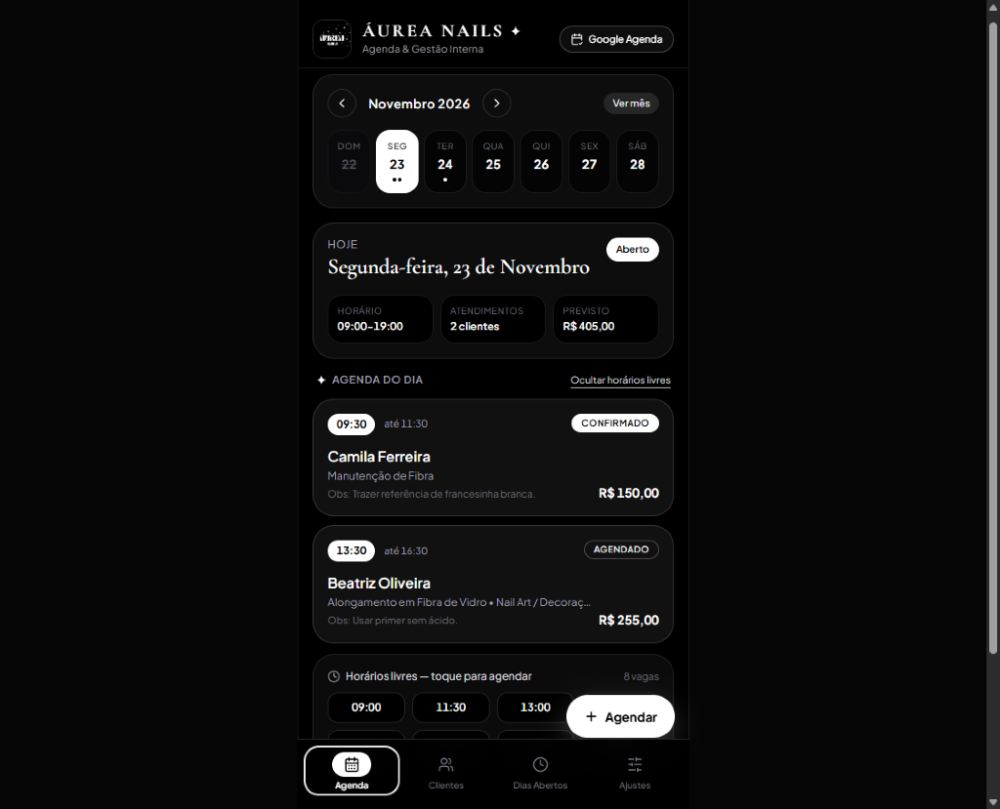
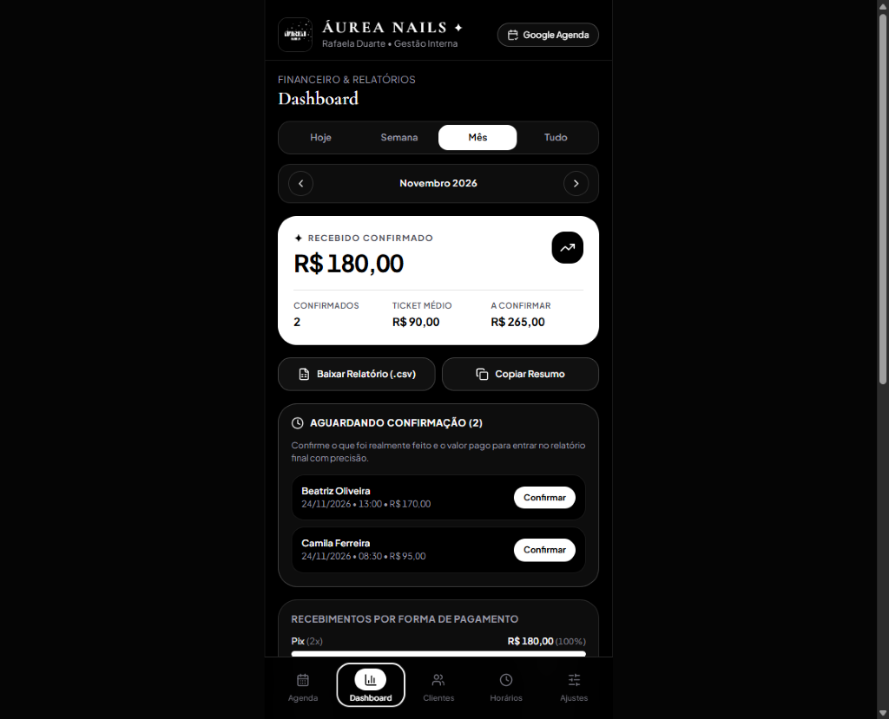
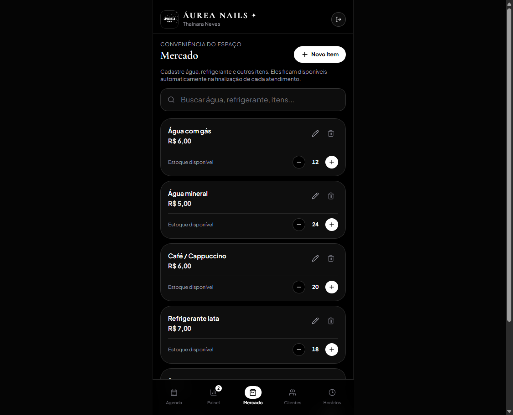

  <h1>✦ ÁUREA NAILS — Gestão Mobile para Studio de Nail Design</h1>
  

    <strong>Sistema Web Mobile-First (PWA)</strong> sob medida para gestão interna de agenda, clientes, conveniência (Mercado), Google Agenda compartilhado e financeiro em tempo real.
  

  

    
    
    
    
    
  

---

## Sobre o Projeto

O **Áurea Nails** foi projetado pela **Zykon** com foco total em **usabilidade pelo celular** para a equipe interna de um estúdio de Nail Design. A interface segue fielmente a identidade visual monocromática (**preto e branco**) de alto contraste, com navegação pensada para uso rápido com uma mão entre um atendimento e outro.

> *Nota: O código-fonte de produção é mantido em repositório privado por ser um software sob medida para cliente. Este repositório apresenta a arquitetura, funcionalidades e telas reais da solução.*

---

## Telas Reais (Mobile-First)

<table>
  <tr>
    <td align="center" width="33%">
      <strong>Agenda &amp; Horários Livres</strong>  
      
    </td>
    <td align="center" width="33%">
      <strong>Dashboard &amp; Confirmação</strong>  
      
    </td>
    <td align="center" width="33%">
      <strong>Mercado &amp; Estoque</strong>  
      
    </td>
  </tr>
</table>

---

## Funcionalidades Entregues

- **Agenda Inteligente &amp; Dias Abertos**
  - Definição completa dos dias e horários de abertura pela profissional (**Semana Padrão** + exceções por data no **Calendário do Mês**).
  - Cálculo automático de horários livres e detecção de conflitos **por profissional**.
  - Seleção da profissional responsável no agendamento, permitindo que uma profissional marque horários para a outra.
  - Mensagem de confirmação pronta para envio via **WhatsApp** em 1 toque.

- **Integração com Google Agenda Compartilhado**
  - Envio em 1 toque, exportação `.ics` e sincronização via **Google Calendar API (OAuth 2.0)** identificando automaticamente no título do evento qual profissional atenderá a cliente.

- **Confirmação do Atendimento + Mercado do Espaço**
  - Fluxo de fechamento assistido onde a profissional confirma **quem realizou**, **quais procedimentos foram realmente executados**, **itens consumidos do Mercado** (água, refrigerante, café, etc.), **forma de pagamento** (`Pix`, `Crédito`, `Débito`, `Dinheiro`) e **valor final recebido**.
  - Aba **Mercado** com cadastro de produtos, valores e controle de estoque em 1 toque.

- **Dois Acessos &amp; Dashboard Financeiro Preciso**
  - Acesso por PIN individual: visão completa do estúdio (com filtro por profissional e comparativo de faturamento) para a proprietária e painel exclusivo para a profissional.
  - Exportação de relatório detalhado em **`.csv` (Excel/Google Sheets)** e resumo formatado pronto para compartilhamento.

- **Sincronização Multi-Celular em Tempo Real**
  - Arquitetura híbrida com `localStorage` + **Supabase Realtime**, sincronizando clientes, agendamentos, estoque e financeiro instantaneamente entre aparelhos.

---

  
✦ Desenvolvido por <strong>Zykon</strong>

